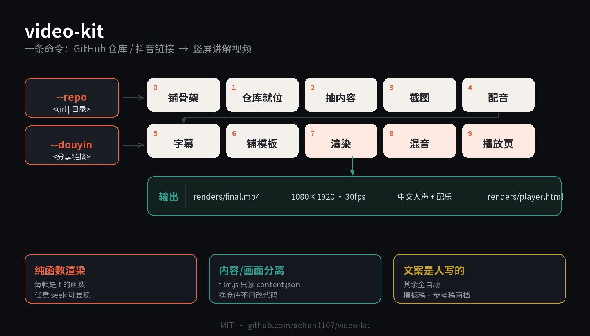
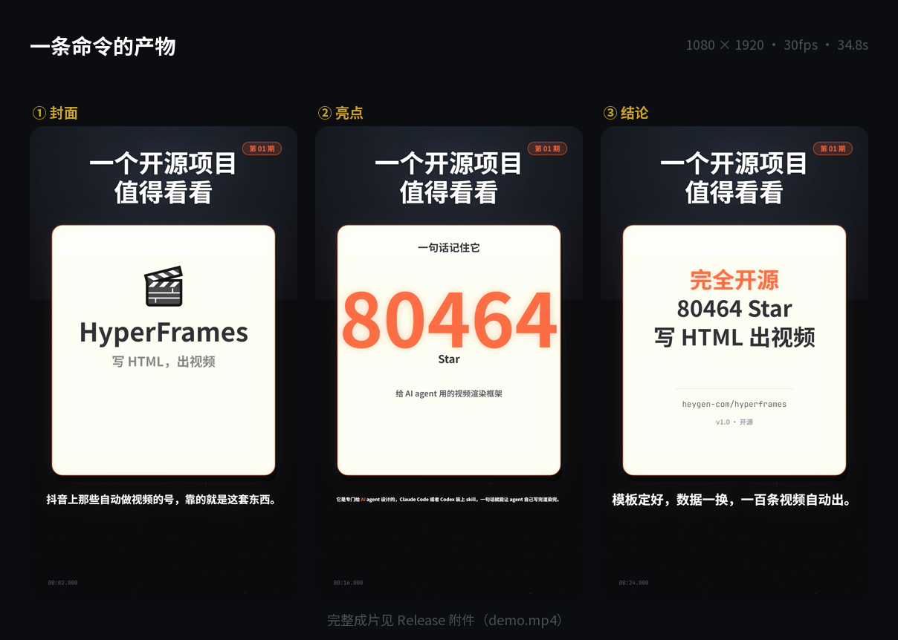

# video-kit

[](https://github.com/achun1107/video-kit/actions/workflows/ci.yml)
[](LICENSE)
[](package.json)
[](requirements.txt)
[](tests/)
[](tools/make-video.mjs)
[](docs/ARCHITECTURE.md)

**一条命令，把 GitHub 仓库或者抖音视频变成一条竖屏讲解视频。**

输入一个仓库地址（或一条抖音分享链接），输出 1080×1920 / 34.8 秒 / 带中文解说和配乐的成片。
卡片、截图、字幕、音效、混音全部自动。



```bash
# 输入 1：GitHub 仓库
node tools/make-video.mjs --repo https://github.com/webkubor/dsh-bloom-theme --out ./my-video

# 输入 2：抖音分享链接
node tools/make-video.mjs --douyin "https://v.douyin.com/xxxxxx/" --out ./my-video
```

---

## 看看出片长什么样



一条真实产出的片子（讲 [heygen-com/hyperframes](https://github.com/heygen-com/hyperframes)）：

▶ **[看完整成片 demo.mp4（34.8s）](https://github.com/achun1107/video-kit/releases/latest/download/demo.mp4)**

> 链接用 `releases/latest`，永远指向最新版的附件，不用跟着发版改。

---

## 安装

### 依赖

| 依赖 | 版本 | 说明 |
|---|---|---|
| **Node.js** | ≥ 18 | 跑 `tools/*.mjs`，零运行时依赖 |
| **Python** | ≥ 3.10 | 渲染、配音、混音、抖音链路 |
| **ffmpeg** | 任意近期版本 | 合成视频；`ffprobe` 要一起装 |

ffmpeg 装法：

```bash
# Windows
winget install ffmpeg
# macOS
brew install ffmpeg
# Ubuntu / Debian
sudo apt install ffmpeg
```

装完新开终端，`ffmpeg -version` 能出东西就行。

### 安装步骤

```bash
# 1. 克隆
git clone https://github.com/achun1107/video-kit
cd video-kit

# 2. 字体（14 个开源字体，43MB，只下一次）
python engine/get_fonts.py

# 3. Python 依赖
pip install -r requirements.txt

# 4. 浏览器（Playwright 用来截帧）
python -m playwright install chrome
```

字体下载走 `raw.githubusercontent.com`，国内可能连不上。连不上就手动下——
脚本会打印每个失败文件对应的 URL，浏览器打开另存到 `engine/fonts/` 即可。

### 验证安装

```bash
npm test          # 60 个测试，全过说明环境没问题
npm run check     # Node 脚本语法
```

### 出片

```bash
node tools/make-video.mjs --repo <仓库地址> --out ./out
```

出片在 `out/renders/final.mp4`，播放页在 `out/renders/player.html`。

### 自检

```bash
npm run selfcheck     # 语法 + 测试 + 死链 + 历史密钥，一条命令
```

拆开跑：

```bash
npm test              # 60 个测试：误听纠正、数字解析、SRT 解析、仓库卫生
npm run check         # Node 脚本语法
npm run lint          # Python ruff 静态检查
npm run links         # 文档外链体检（8 个可达，0 死链）
npm run history       # git 历史里的明文密钥（0 命中）
npm run audit         # Python 依赖漏洞（需先 pip install pip-audit）
npm run vrt           # 视觉回归：渲染 9 帧比对基准
npm run fonts         # 下载 14 个字体
```


---

## 常见问题（FAQ）

### 渲染卡住不动，最后报 `Timeout 180000ms exceeded`

**九成是缺字体。** 缺了 `document.fonts.ready` 永远等不到，渲染就一直挂着。

```bash
python engine/get_fonts.py
```

也可能是内存不够（要 ≥2.5 GB 可用）。开着几十个浏览器标签时常见，
`python tests/vrt.py` 会先预检内存并直接说明。

### `--det` 报 `NOT deterministic`

画面有非确定性来源，三个经典原因：

1. 用了 `ctx.shadow*` — `shadowBlur` 在多图合成时结果不稳，改用深色填充模拟
2. 单帧 `drawImage` 超过 3 次带变换 — 先烤到离屏 canvas
3. 用了 `Math.random()` / `Date.now()` — 换成 `hash(i)`

报错会带坐标 `[t, x, y, w, h]`，按坐标找是哪张卡。

### 卡片里是灰色占位条，没有内容

`index.html` 缺 `content.js` 或 `window.VK_SIZE`：

```bash
grep -c 'content.js' index.html    # 应该是 1
grep -c 'VK_SIZE' index.html       # 应该是 1
```

缺了就 `node tools/make-video.mjs ... --reset-html` 重新生成。

### 画幅变成横屏了

同上，缺 `window.VK_SIZE = { w: 1080, h: 1920 }`，默认会退回 1920×1080。

### 文字重叠 / 章节号看不见

两个经典翻车：

- **同色系文字压同色系背景** — 章节号用了分类色，背景也是分类色，改用 `C.ink`
- **文字密集的卡片里又贴了文字密集的截图** — 两者打架，截图要么单独一卡要么不放

### 大仓库 clone 超时

180 秒上限。两个办法：用 `tools/repo-content.py` 走 GitHub API（不 clone），
或者手工把仓库放到 `_repos/<name>/`。

### 文案出来是通用套话

对，模板稿就这样。**文案是唯一必须人写的部分**：

```bash
vim audio/copy.json
python tools/tts.py <工程>
```

### 抖音下载失败 / 抓不到列表

- `Fresh cookies are needed` → 脚本已绕过（提取 mp4 直链），如果还失败通常是页面结构变了
- 抓 0 条 → 抖音要登录，或页面改版

### 识别出的仓库不对

口播没念仓库名，只能猜。看 `found.json` 里的 `candidates` 手工确认，
或者 `--repo <owner/repo>` 直接指定。

**完整版见 [docs/FAQ.md](docs/FAQ.md)**（还包含 Edge 浏览器、并发渲染、替换配乐等问题）。

---

## 它做了什么

七张卡，固定结构，内容全部来自仓库：

| 卡 | 内容 |
|---|---|
| 1 | 封面：emoji + 名字 + 一句话 + 三个标签 |
| 2 | 数字墙：star / fork / 功能数 |
| 3 | GitHub 截图（带放大圈选） |
| 4 | 特性列表（前 4 条） |
| 5 | 亮点数字 |
| 6 | 清单（章节目录 / 配色表） |
| 7 | 结论 |

抖音视频走同一套流程，只是多了一步「先反查视频里讲的是哪个仓库」。

### 实测样例

| 输入 | 结果 |
|---|---|
| `webkubor/dsh-bloom-theme` | 15 色块墙 + 真实界面截图 + 4.5:1 大数字 |
| `webkubor/xiaobai-kanban` | 14 章目录 + 术语对照 + 费用柱状图 |
| `heygen-com/hyperframes` | 8 万 star 数字墙 + 四步流程 |
| 抖音「Codex 自动化链路」 | 自动识别出 `heygen-com/hyperframes` 并出片 |

---

## 为什么快

**画面是 `t` 的纯函数。** 没有跨帧状态、没有随机数，任意时刻都能直接算出一帧。

所以：

```bash
python engine/render.py <工程> --stills 10.5   # 直接看第 10.5 秒
python engine/render.py <工程> --clip 0 12     # 只渲前 12 秒
python engine/render.py <工程> --det           # 两次渲染必须一模一样
```

`--det` 通过是整个项目的地基——没有它，改一版画面要等 5 分钟才知道对不对。

**内容层与画面层分离。** `film.js` 只读 `content.json`，不写死任何项目信息。
字段缺了那张卡就跳过，不报错。换一个仓库出片，理论上不用改代码。

**文案是唯一必须人写的部分。** 其余全部自动。

---

## 参数

```
--repo <url|目录>      输入 GitHub 仓库
--douyin <分享链接>    输入抖音视频
--out <目录>           默认 ./video-out
--skip-render          只做到「配音 + 模板」，不渲染
--reset-film           用模板覆盖已有的 film.js
--reset-html           重新生成 index.html
--music <mp3>          换配乐，默认 Carefree
--asr-model <size>     抖音转写模型，默认 small
--try <N>              抖音逐条试几条，默认 4
--video <id>           抖音指定某条视频
```

环境变量 `GITHUB_TOKEN` 有值时，会用 API 抽内容（避免 403 和 clone 超时）。

---

## 抖音链路

分享链接 → 抓列表（带点赞数）→ 逐条试 → 下载 → 本地转写 → 反查仓库 → 出片。

**为什么要逐条试**：点赞最高的那条往往不是 GitHub 项目（比如讲 ChatGPT 内置功能的），
盲选第一条必然失败。实测 5 条高赞视频：

| 点赞 | 识别出的仓库 | |
|---|---|---|
| 18,470 | — | 不是 GitHub 项目，正确判为「无仓库」 |
| 15,930 | `bytedance/UI-TARS-desktop` | ✅ |
| 11,979 | `heygen-com/hyperframes` | ✅ |
| 3,724 | `Renhuai123/ziwei-doushu` | ✅ |
| 373 | `microsoft/agent-lightning` | ✅ |

反查靠三样东西：口播里的 **star 数**（最强指纹）、**公司名**（字节→bytedance）、
**jieba 关键词**。三样都命中且领先第二名够多才采信，否则报「没把握」而不是硬凑。

细节见 [架构说明](docs/ARCHITECTURE.md#抖音链路)。

---

## 文档

| 文档 | 内容 |
|---|---|
| [完整用法](docs/USAGE.md) | 参数、字段、时间轴、配色、配乐 |
| [常见问题](docs/FAQ.md) | 装不上、渲不出来、`--det` 不过、文字重叠 |
| [架构说明](docs/ARCHITECTURE.md) | 为什么每帧是纯函数、三层职责、扩展点 |
| [变更记录](CHANGELOG.md) | 版本历史 + 踩过的坑 |
| [参与贡献](CONTRIBUTING.md) | PR 标准、代码规范、提交信息格式 |
| [安全策略](SECURITY.md) | 报告漏洞、它会碰什么、不会碰什么 |
| [AGENTS.md](AGENTS.md) | 给 AI 助手的仓库行为准则 |
| [llms.txt](llms.txt) | 给 LLM 的导读 |

---

## 目录

```
engine/
  vk.js          渲染引擎（每帧是 t 的纯函数）
  vk-kit.js      语法件：字幕、数字轮、章节点、圈选
  render.py      Playwright 逐帧截图 → ffmpeg
  audio.py       合成配乐与音效
  get_fonts.py   下载 14 个开源字体（不进库）

tools/
  make-video.mjs     九步编排器
  film-template.js   通用七卡模板
  tts.py             edge-tts 配音 + SRT + 字幕表
  mix.py             三层混音（人声/音效/配乐）
  extract-content.mjs 仓库 → content.json
  repo-content.py    走 API 生成 content.json（避开 clone 超时）
  shot-github.py     截 GitHub 页
  make-player-html.py 自包含播放页
  douyin-rank.py     抖音列表 + 点赞数
  douyin-download.py 提取 mp4 直链下载
  transcribe-local.py faster-whisper 转写
  repo-finder.py     从转写反查仓库
  asrfix.py          whisper 中文误听纠正
  reverse-batch.py   批量逆向高赞视频
  script-writer.py   生成两档文案

docs/              用法、FAQ、架构
audio/bgm/         6 首免版权配乐
```

---

## 已知限制

1. **文案必须人写** — 自动生成的是通用模板稿，读起来是套话
2. **私有仓库不行** — 抽内容要读文件
3. **渲染 3–6 分钟** — 1044 帧，慢是正常的
4. **抖音需要能访问抖音** — 网络不通就没法下载
5. **测试只覆盖纯函数** — 60 个测试管误听纠正、中文数字解析、SRT 解析、仓库卫生，
   但渲染正确性只有 `--det` 那一道关，没有像素级比对

## 质量

| 项目 | 状态 |
|---|---|
| 单元测试 | 60 个，`npm test` |
| CI | GitHub Actions，语法 + 测试 + 结构 + 密钥扫描 |
| 渲染确定性 | `--det` 两次结果比 md5 |
| 死链检查 | `npm run links`，当前 7 个外链全通 |
| 历史密钥扫描 | `npm run history`，当前 0 命中 |

## 授权

MIT，见 [LICENSE](LICENSE)。

字体是 SIL OFL 1.1，配乐是 CC BY 4.0（Kevin MacLeod），第三方授权详见 [NOTICE](NOTICE)。
